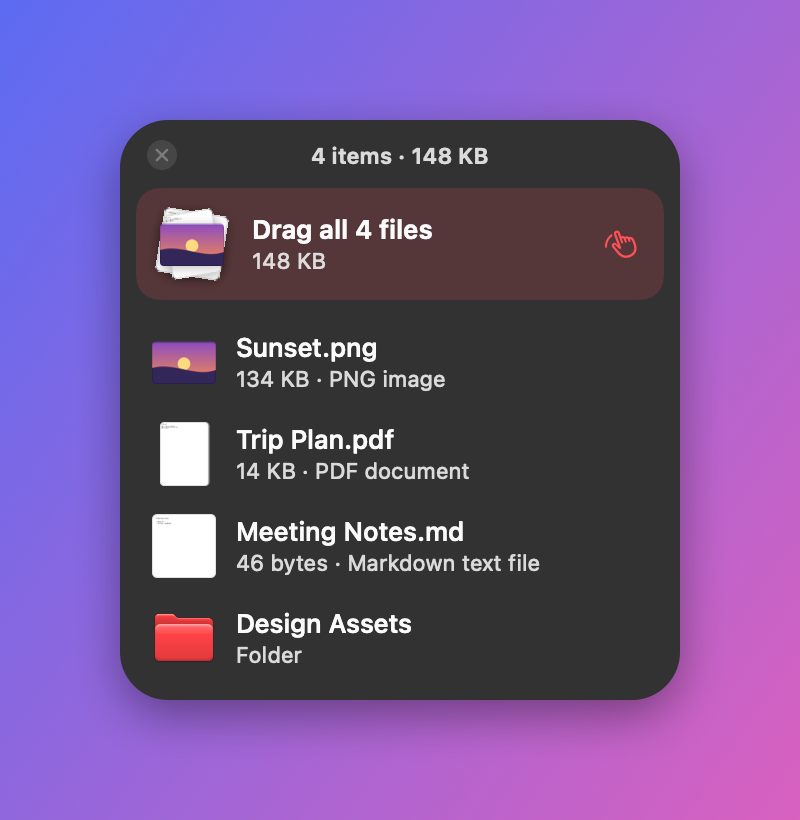
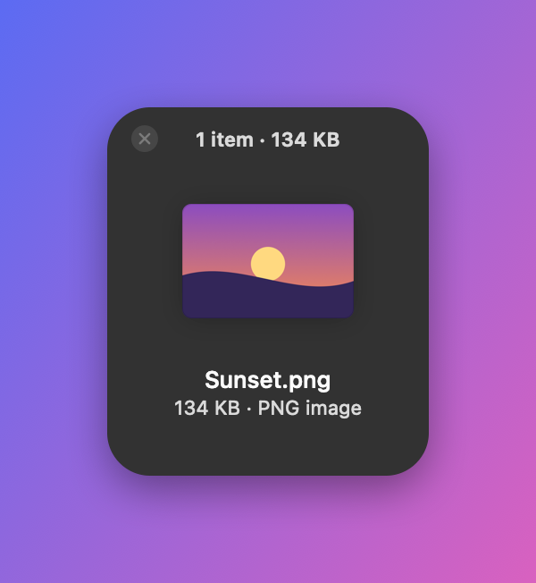

<p align="center"></p>

# Shelfy

A free, open-source drag-and-drop shelf for macOS. Shake your mouse while dragging files and a small floating shelf appears. Drop the files on it, go wherever you need to, then drag them out again, together or one at a time.

<p align="center">
  
  
</p>

> The screenshots use a plain background. In the app, the shelf uses macOS Liquid Glass on macOS 26 and a frosted blur on older versions.

## Features

- **Shake to open:** while dragging files, shake the cursor left and right and a shelf appears next to it.
- **Drag files out one by one:** with two or more files, each file has its own row, so you can drop them in different places. A **Drag all** row moves everything at once.
- **Real previews:** images, PDFs and documents show Quick Look thumbnails, with size and file type.
- **Stays out of the way:** the shelf floats above other windows, on every desktop and over full-screen apps, without taking focus from the app you're dragging from.
- **Closes itself** once the last file is dragged out.
- **Several shelves** at once, from the menu bar icon or by shaking again.
- **Shake sensitivity:** Normal, High or Very High.
- Right-click a file to open it, show it in Finder or remove it from the shelf. Double-click to open.
- Follows Light and Dark Mode and your accent color.
- Universal app: runs natively on Apple silicon and Intel Macs.

## Install

1. Download `Shelfy.zip` from the [latest release](../../releases/latest) and unzip it.
2. Move `Shelfy.app` to your Applications folder.
3. Open it. Shelfy isn't notarized by Apple, so the first time macOS blocks it:
   - **macOS 15 and later:** open **System Settings → Privacy & Security**, scroll down, and click **Open Anyway** next to the Shelfy message.
   - **macOS 13–14:** right-click `Shelfy.app`, choose **Open**, then click **Open** again.

   Or run this once in Terminal: `xattr -dr com.apple.quarantine /Applications/Shelfy.app`

Shelfy lives in the menu bar (no Dock icon). To start it automatically, add it in **System Settings → General → Login Items**.

Requires macOS 13 Ventura or later. No permissions are needed: watching mouse drags doesn't require Accessibility access.

## How to use

1. Start dragging one or more files, from Finder, the desktop or any app.
2. While holding them, shake the mouse left and right a few times. A shelf appears.
3. Drop the files on the shelf.
4. Later, drag them out:
   - drag a single row to move just that file
   - drag **Drag all** to move all of them together
5. When the shelf is empty it closes. You can also close it with the ✕ button.

From the menu bar icon you can open a **New Shelf**, **Close All Shelves**, change the **Shake Sensitivity**, or quit.

## Build from source

You need the Xcode Command Line Tools (`xcode-select --install`). No Xcode project is required.

```sh
git clone https://github.com/adamly218/shelfy.git
cd shelfy
./build.sh
open Shelfy.app
```

`build.sh` compiles a universal binary and ad-hoc signs it. To regenerate the README screenshots, run `./scripts/screenshots.sh`. The app icon is drawn in code by `scripts/make-icon.swift`; run `./scripts/make-icon.sh` after changing it.

## How it works

| File | What it does |
| --- | --- |
| [`ShakeDetector.swift`](Sources/ShakeDetector.swift) | Watches mouse drags in other apps with a global event monitor. A drag counts as a file drag when the system drag pasteboard changes and contains file URLs. A shake is several quick left-right direction changes within 0.8 seconds. |
| [`ShelfPanel.swift`](Sources/ShelfPanel.swift) | The floating, non-activating glass window, its header, and its open, close and resize animations. |
| [`ShelfView.swift`](Sources/ShelfView.swift) | Accepts dropped files and switches between the empty, single-file and list layouts. |
| [`DraggableFilesView.swift`](Sources/DraggableFilesView.swift) | File rows and the **Drag all** row, which start a drag session for their own files. |
| [`FileInfo.swift`](Sources/FileInfo.swift) | Quick Look thumbnails, file sizes and types. |
| [`MenuBarIcon.swift`](Sources/MenuBarIcon.swift) | Draws the menu bar icon as a template image. |

The shelf only holds references to your files. It never copies or moves them itself; the app you drop them into decides that, as with any normal drag.

## Contributing

Issues and pull requests are welcome.

## License

[MIT](LICENSE). Shelfy is inspired by drag-and-drop shelf apps such as Dropover. It's an independent project and isn't affiliated with them.
